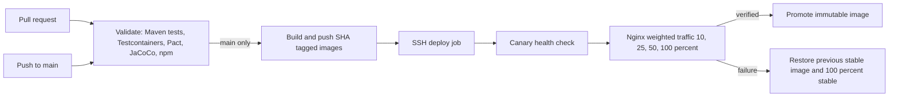
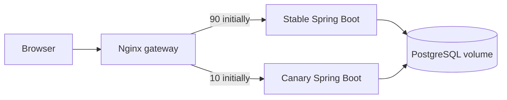

# Combined Experiment: Full Stack CI/CD with Docker and Canary Deployment

## Aim and objectives

Combine the existing React/Vite and Java 17/Spring Boot CI experiment with repeatable container builds and a server side canary release procedure. The pipeline validates before publishing SHA tagged images, and the deploy script checks health before promotion and restores the last recorded stable image after a failed step.

## Requirements and theory

Use Java 17, Maven, Node.js 20/npm, Docker Engine with Compose v2, Nginx, and a Linux host reachable over SSH. CI runs JUnit/Mockito, MockMvc, Pact provider verification, Testcontainers PostgreSQL, JaCoCo, TypeScript, and Vite production build. CI catches defects before delivery; immutable images make the deployed artifact identifiable; weighted reverse proxy traffic reduces the initial exposure to a release.

## Architecture





The initial 90/10 split is an experiment strategy, not evidence of production readiness. Health endpoints show process availability only. Extend `deploy/deploy.sh` observation gates with application-level error rate, latency, and business metric queries before treating a canary as reliable.

## Local use

Copy `.env.example` to `.env` and replace the sample database password and ingestion token. Build the backend image and run the stack:

```sh
docker build -f backend/Dockerfile -t ci-quality-dashboard-backend:local backend
docker compose --env-file .env up --build -d
docker compose ps
curl http://localhost:8080/api/health
```

The dashboard is at `http://localhost:3000`. PostgreSQL has no published host port and persists in `postgres_data`. Stable and canary run at once; locally both use the same image until a different `CANARY_IMAGE` is supplied. Check proxy config with `docker compose exec gateway nginx -t`. Run `mvn -f backend/pom.xml clean verify` and `npm install && npm run lint && npm run build` for automated validation. Testcontainers requires Docker.

## Docker Hub and Actions configuration

Create Docker Hub access token with repository write permission. Add GitHub Actions secrets `DOCKERHUB_USERNAME`, `DOCKERHUB_TOKEN`, `DEPLOY_HOST`, `DEPLOY_USER`, `DEPLOY_SSH_KEY`, `DEPLOY_PORT` (optional; defaults to 22), and `DEPLOY_PATH`. Configure a protected `production` environment and restrict its allowed deployment branches to `main`. Pull requests only run validation and receive no deployment credentials. Images use the full source commit SHA tag; no `latest` tag is deployed.

## Linux host preparation and deployment

Install Docker Engine/Compose, restrict SSH and firewall ingress, and serve the public site behind HTTPS. Do not expose the Docker socket or PostgreSQL. Copy `docker-compose.yml`, `deploy/`, `frontend/`, and the executable deploy script into `DEPLOY_PATH`. On the host, create `.deploy.env` containing database values and `CI_INGESTION_TOKEN`; restrict it to the deploy user (`chmod 600`). Ensure that user can run Docker. For private Docker Hub repositories, authenticate the host's Docker client using a read-only token outside the workflow logs.

Set `DEPLOY_IMAGE` to `docker.io/USER/ci-quality-dashboard-backend:FULL_SHA` and run `./deploy/deploy.sh`. The deploy script pulls by immutable tag, starts the candidate, checks its `/api/health`, validates Nginx config with `nginx -t`, reloads Nginx, and advances traffic through 10%, 25%, 50%, and 100%. A failed gate restores the previous stable image and Nginx stable-only routing; it never deletes the database volume. Successful promotion records image tags in `.deploy-state`.

Use `DRY_RUN=true DEPLOY_IMAGE=registry/name:FULL_SHA ./deploy/deploy.sh` to print the planned steps without contacting Docker or modifying state. Manual rollback: set `DEPLOY_IMAGE` to the previously recorded `STABLE_IMAGE` in `.deploy-state` and run the deployment procedure; the state file is deliberately retained. Verify with `docker compose ps`, `docker compose logs --tail=100 stable canary gateway`, `docker compose exec gateway nginx -t`, and `curl -fsS https://YOUR_HOST/api/health`.

## Expected results and learning outcomes

The Actions workflow validates PRs, then only on main publishes backend and frontend images and invokes deployment. The remote deployment can be independently repeated using its SHA tag. Learners can inspect test reports, image provenance, proxy weighting, health gates, and rollback behavior. The dashboard currently does not read a protected deployment report, so it must not present synthetic stable/canary state; absent a real reporting endpoint the deployment status is **Not configured**.

## Validation record

Record commands and results after running them in the target environment. Docker daemon, Docker Hub credentials, Actions secrets, and a remote Linux host are environment-specific prerequisites; a local configuration check does not establish that a remote deployment succeeded.
